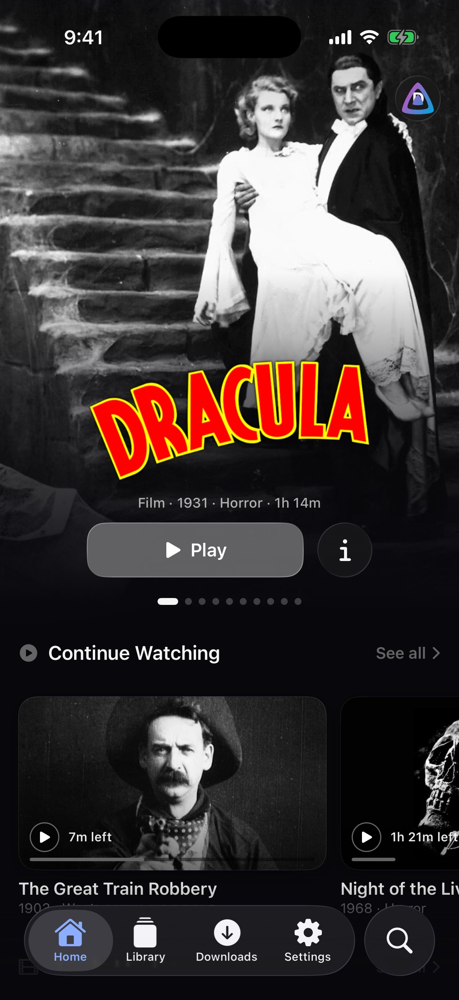
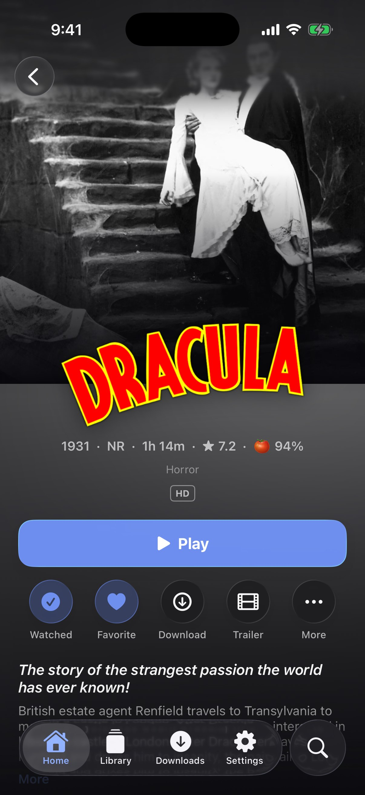
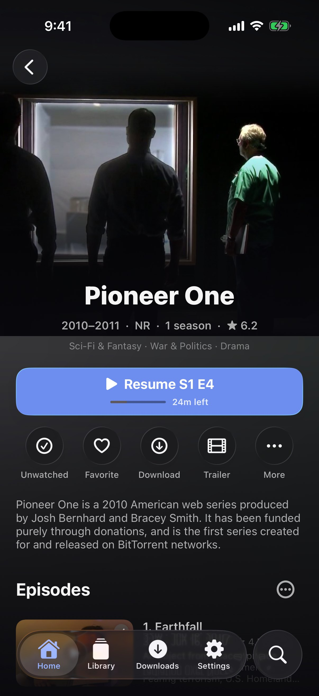
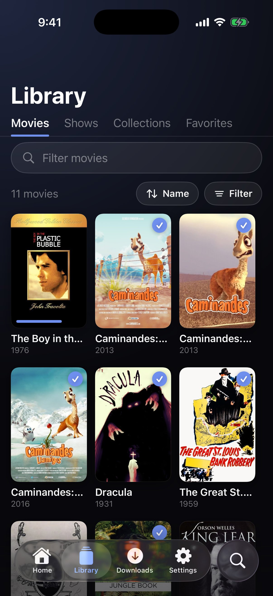
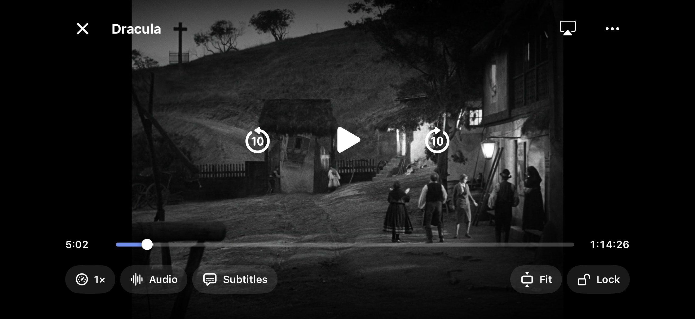

# Kinema


A native iPhone and iPad client for [Jellyfin](https://jellyfin.org): your
films and shows, browsed on pages that take their colour from the artwork,
and played in a player made for watching. It has the look and feel of
[Kultr](https://kultr.cc) (liquid glass, a floating tab bar, artwork-tinted
pages) and the features you'd expect from the best paid video players,
for free.

<p>
  
  
  
  
</p>


## Features

- **Home** with a big carousel of what's new, **Continue Watching**,
  **Next Up**, the newest in each library, favourites, collections and
  genres. Choose the sections and their order in Settings.
- **Title pages** with the backdrop across the top (pull to stretch), the
  title's logo, year, rating, length and badges for 4K, HDR, Dolby Vision,
  Atmos and 5.1, then Play or Resume, watched, favourite, download and
  trailer. Shows list their seasons and episodes; every page has cast &
  crew, extras, similar titles, details and the file's tracks. Pick another
  version when a title has several.
- **Libraries** as posters, swiped through left and right, with sorting
  (name, date added, release date, rating, length, last watched, random),
  filters (unwatched, watched, in progress, favourites, genres, years), an
  A–Z jump down the side and a quick filter field. Collections and
  Favorites have pages of their own.
- **Search** across films, shows, episodes, people and collections as you
  type, with recent searches and genres to browse.
- **A player made for watching.** Tap to show the controls, double-tap
  either side to skip (keep tapping to skip further), hold anywhere for 2×
  (swipe up to keep it), swipe up and down on the left for brightness and on
  the right for volume, swipe sideways to seek with thumbnails from the
  server's trickplay images, pinch to fill the screen. Speeds from 0.25× to
  4×, chapters, **Skip Intro**, **Skip Credits** and **Up Next** with a
  countdown, previous and next episode, an episode list, screen lock,
  fit / fill / stretch, Picture in Picture, AirPlay, lock-screen controls,
  playback info (method, codecs, bitrates, dropped frames), screenshots
  (JPEG, PNG or HEIC) and **GIF recording**. The next episode is preloaded
  near the end. Where the server knows no intro or credits, Kinema finds
  them in the online databases [TheIntroDB](https://theintrodb.org) and
  [IntroDB](https://introdb.app), or you mark them once for the whole show.
- **Subtitles drawn by Kinema**, in your style: size, colour, outline,
  background, brightness, font and position, a **second subtitle track** at
  the same time, a delay to fix out-of-sync files, and a **search for
  subtitles online** through your server's providers. SRT, ASS/SSA and
  WebVTT are read directly; picture subtitles (PGS, VobSub) are drawn into
  the video by the server.
- **Plays everything your server has.** MP4 and MOV files play as they are;
  MKV, AVI, WebM, DTS, TrueHD and the rest are repackaged into HLS by the
  server on the fly (copying the streams, so nothing is lost) or converted
  when needed. HEVC, HDR10, HLG and Dolby Vision play where the iPhone can.
  Watching is reported to the server, so progress follows you everywhere.
- **Downloads** for watching offline, as the original file or a smaller
  copy made by the server, with their subtitles and artwork, several at a
  time, with a floating progress strip. A show's unwatched episodes download
  in one go, Kinema can keep the next episodes of the shows you're watching
  downloaded by itself, and an icon by each title says whether it's
  downloaded, whole or in part. What you watch offline is sent to the server once you're
  back online.
- **Settings for everything**, modelled on VidHub's: hide spoilers, default
  sorting, a prompt before streaming on mobile data, the maximum cache,
  decoding switches, when the controls hide, landscape by default, seek
  sensitivity, subtitle rules, GIF frame rate and size, concurrent
  downloads, and for admins library scans and metadata refreshes.
- **Several servers and users**, sign-in with a password or **Quick
  Connect**, a list of the server's users to tap, and Jellyfin's demo server
  to try without one. Kinema can also sign other devices in with Quick
  Connect, from Settings → Accounts.
- **Liquid glass** on iOS 26 (the system's own tab bar with the round
  search button); on iOS 17 and 18 Kinema draws a floating glass bar that
  behaves the same way. Dark, light or automatic, and **Night mode** for
  OLED screens.
- **Updates from inside the app**: Kinema tells you about new versions,
  shows what's new, and hands the update to SideStore or AltStore.

## Getting it

Kinema isn't on the App Store. You install it yourself, a process called
*sideloading*, which works on any iPhone or iPad running iOS 17 or later
without jailbreaking. All you need is a free Apple ID and a computer
(Windows, macOS or Linux), or SideStore on the iPhone.

**➡️ Step-by-step guide for first-timers: [docs/INSTALL.md](docs/INSTALL.md)**

In short: download `Kinema.ipa` from the
[latest release](https://github.com/evropiani/Kinema/releases/latest),
then install it with your Apple ID using
[Sideloadly](https://sideloadly.io) (Windows, macOS),
[AltStore](https://altstore.io) (Windows, macOS),
[Impactor](https://github.com/khcrysalis/PlumeImpactor) (Linux) or
[SideStore](https://sidestore.io) (on the iPhone).

With a free Apple ID the app has to be re-signed every 7 days. SideStore and
Sideloadly can do that for you automatically. Your servers, downloads and
settings survive it, and installing a new release over the old one keeps
them too.

The IPA is unsigned: the tool you install it with signs it for your device.
Every push to `main` is built by GitHub Actions, and the resulting IPA
replaces the one on the current release.

## Building

Requirements: macOS with Xcode 26 or newer (the iOS 26 SDK; the app itself
runs on iOS 17 and later). Then:

```sh
swift test --package-path KinemaCore    # core unit tests, no simulator needed (also runs on Linux)
open Kinema.xcodeproj                   # choose your team under Signing & Capabilities, then Run
```

The core tests can also run against a real server:

```sh
KINEMA_LIVE_SERVER=https://demo.jellyfin.org/stable KINEMA_LIVE_USER=demo swift test --package-path KinemaCore
```

To build the same unsigned IPA the workflow publishes:

```sh
xcodebuild build -project Kinema.xcodeproj -scheme Kinema -configuration Release \
  -sdk iphoneos -destination 'generic/platform=iOS' -derivedDataPath build \
  CODE_SIGNING_ALLOWED=NO
mkdir -p Payload && cp -R build/Build/Products/Release-iphoneos/Kinema.app Payload/
zip -qry Kinema.ipa Payload
```

### Releasing

Bump `MARKETING_VERSION` in `Kinema.xcodeproj/project.pbxproj`, add notes as
`.github/release-notes/v<version>.md`, and push to `main`. The **iOS**
workflow runs the core tests, builds the IPA and publishes it as the GitHub
release `v<version>`, creating the release if it doesn't exist yet or
replacing its IPA if it does. The build number is the workflow's run number.

On other branches the workflow builds for the simulator instead, signs in to
Jellyfin's demo server and takes screenshots of the main screens, which it
pushes to the `ci-screenshots` branch.

It then adds the release to the AltStore / SideStore source kept in a gist
(by `.github/scripts/update-source.py`), when the repository has a
`GIST_TOKEN` secret (a classic token with only the *gist* scope).

## How it is put together

| Part | What it holds |
| --- | --- |
| `KinemaCore` | Plain Swift, no UIKit or AVFoundation: the Jellyfin API client and its models, the device profile that tells the server what the iPhone plays, the stream resolver (direct play, remux or transcode; track choice by language and subtitle mode), the SRT / WebVTT / ASS subtitle parsers, BlurHash, formatting, versions and release notes, the download records and the settings model. A Swift package, unit-tested with `swift test`. The app compiles the same sources directly. |
| `Kinema` | The iOS app: accounts in the Keychain, the player (AVPlayer with Kinema's own subtitle renderer, gestures, segments, Up Next, Picture in Picture, Now Playing and progress reporting), background downloads (files and HLS movie packages), and the SwiftUI interface. |

No third-party dependencies: SwiftUI, AVFoundation, AVKit, MediaPlayer,
VideoToolbox and Network from the iOS SDK.

## License

Apache License 2.0. See [LICENSE](LICENSE).
